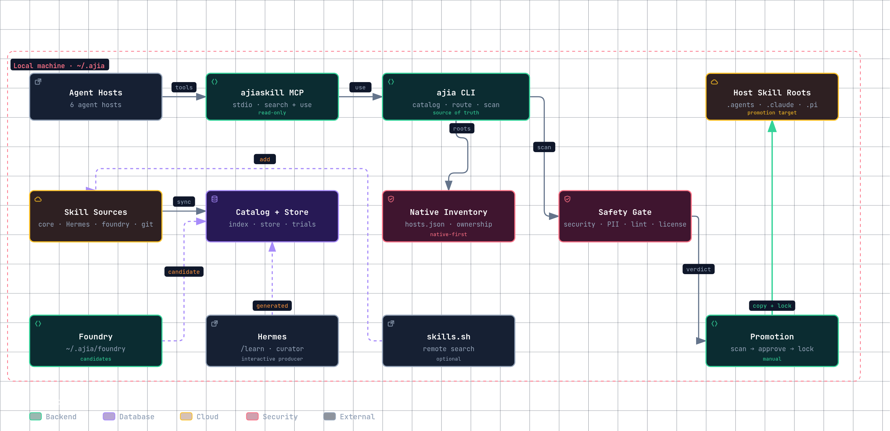
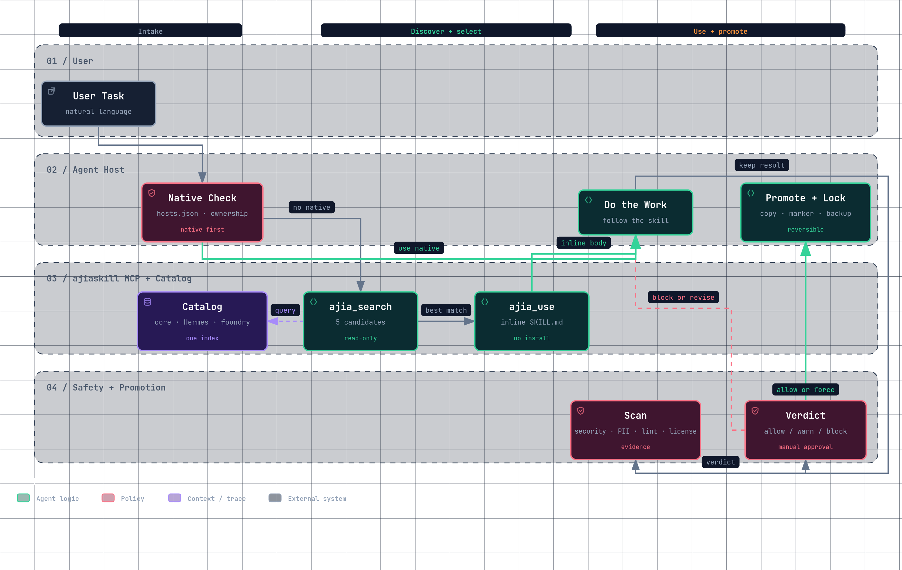
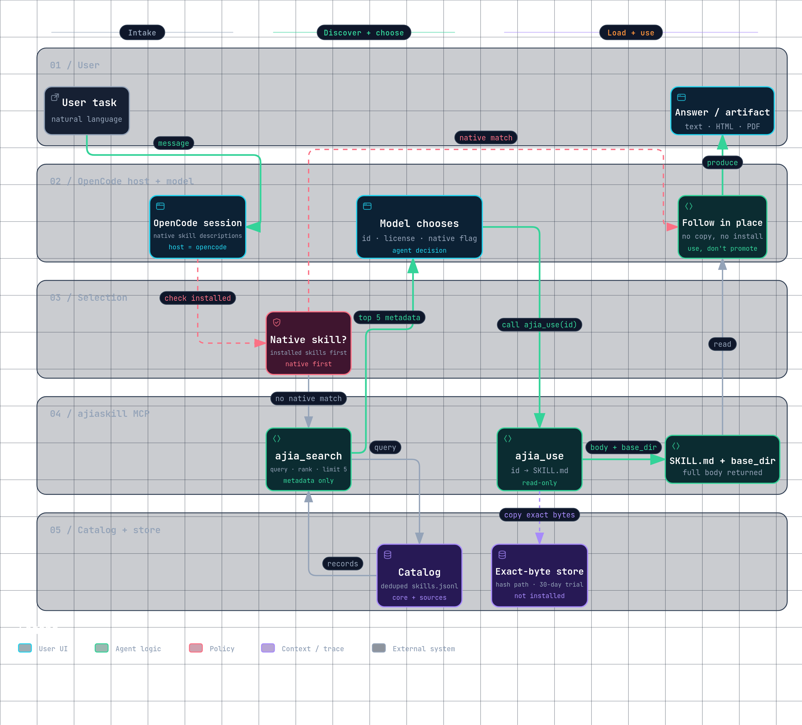
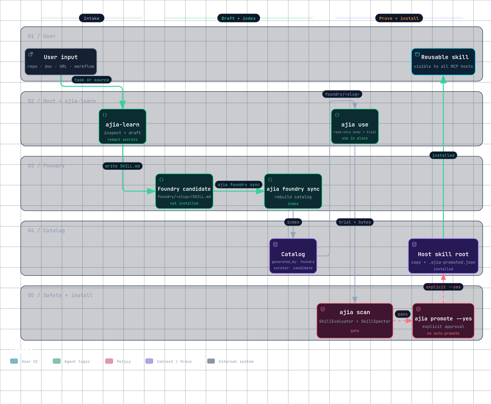

# ajiaskill

A local skill platform for coding agents. State the feature or task; the host detects the right core skill and ajiaskill serves it. One catalog, one personal profile, one MCP server, and six hosts share the same setup.

Status: **Phase 4: automatic learning and host integrations.** Catalog, search/use, MCP, safety, promotion, rollback, native inventory, remote source add, cross-agent foundry, profiles, automatic learning, and host integrations exist. Automatic skill detection, native-first routing, body and optional dense retrieval, an optional 0-2 gate, review-to-learn authoring, and one personal profile across six hosts exist. MCP is the default trigger; host plugins and hooks are opt-in through the setup commands.



The [interactive architecture diagram](docs/diagrams/ajiaskill-architecture.html) pans, zooms, and switches themes.

## What it does

- **Automatic skill detection:** the user states the task or feature, not a skill name. The host reads it; native descriptions, the MCP trigger policy, and `ajia_search` / `ajia_use` select the skill. `ajia route --gate` adds an optional 0-2 model gate; a hook can make the choice deterministic.
- **Unified personal settings:** one `~/.ajia` home and one profile control sources, hosts, routing thresholds, and safety policy across all six hosts. Core skills are the shared baseline; switching profiles does not reinstall them.
- **Catalog:** indexes `SKILL.md` files from local and git sources.
- **Search:** ranks by name, description, path, and use count, then reranks the top candidates with a full-body BM25 pass and RRF. Duplicate names keep the core copy.
- **Use:** copies the exact bytes to a read-only store and returns the full `SKILL.md` to the agent. Use it in place; copying it into a host skill directory is installation.
- **MCP (default):** the `ajiaskill` server exposes `ajia_search` and `ajia_use` as tools. The agent calls them when no native or core skill fits.
- **Router (optional):** `ajia route` maps a message to one skill with rules and metadata. `ajia-router` is the fallback skill. Host hooks are reference-only.
- **Remote search:** queries `skills.sh`.
- **Remote source path:** `ajia remote add` turns a skills.sh result into a pinned git source, syncs it, and finds the skill in the catalog.
- **Remote install:** wraps `npx skills add` when you explicitly want the upstream installer.
- **Scan:** NVIDIA SkillEvaluator and SkillSpector plus a built-in tripwire.
- **Promote:** manual, gated, backed up, and recorded in a lock file.
- **Sandbox:** prints a no-network, read-only Docker command for source scripts.
- **Foundry:** writes cross-agent candidates under `~/.ajia/foundry`, and indexes Hermes `/learn` skills as candidates.
- **Profiles:** one personal profile controls sources, hosts, routing thresholds, and safety policy across every host.
- **Generated metadata:** Hermes `created_by` and curator state, plus foundry candidates, appear in the catalog.
- **Automatic learning:** `ajia review` and the host integrations review a finished turn and queue an evidence-backed lesson. `ajia learn` is the only author: it scores the lesson against a rubric, deduplicates against the catalog, writes a learn-owned foundry candidate, scans it, and either stages approval or installs it. Durable memory is injected on later turns.

## Automatic skill detection

You describe the feature or task. You do not name a skill, and you do not wire a command per feature. The host reads the message and detects the skill while you use its features normally.



1. **Native first:** `install.sh` puts core skills in host roots. The host loads their descriptions and may use one directly.
2. **Policy:** the MCP server sends an intent map in its `initialize` response.
3. **Search fallback:** when no native skill clearly fits, the host calls `ajia_search`, then `ajia_use`.
4. **Optional gate:** `ajia route --gate` asks a model to select 0-2 candidates from the retrieved set.
5. **Deterministic path:** `ajia route` or a host hook can inject one skill on every matching turn.

### OpenCode walkthrough

MCP is the tool surface, not the chooser: it never reads the user message, and the host and model decide. That split is the unique part. In OpenCode the path is:

1. **Native check:** OpenCode loads the descriptions of installed core skills from its host roots (mapped in `hosts.json`). A native match wins; `ajia_use` refuses to return a duplicate fallback.
2. **`ajia_search`:** with no native match, the model calls `ajia_search` with the task and `host: opencode`. The server filters by profile source, ranks the catalog (lexical, body BM25, optional dense), and returns metadata only, including id, description, license, risk, and `native_hosts`.
3. **Choose:** the model picks a result id. The server never selects a skill.
4. **`ajia_use`:** the server copies the exact bytes to a content-addressed read-only store, records a 30-day trial, and returns the full `SKILL.md` plus `base_dir`.
5. **Follow in place:** the model follows the returned body. Nothing is installed or promoted; `ajia promote` remains a separate, explicitly approved step.

If no candidate is safe, the correct result is `none`.



The [interactive OpenCode skill discovery workflow](docs/diagrams/opencode-skill-discovery.html) shows the same path as a standalone diagram.

## Unified personal settings

One `~/.ajia` home is shared by every host:

- `profiles.json` controls sources, hosts, routing thresholds, and safety policy.
- `hosts.json` maps the skill roots for OpenCode, Pi, OMP, Codex, Hermes, and Claude.
- `routing.json` and the core skills provide one selection baseline.
- `install.sh` links the same core skills into the host roots.
- `ajia profile use work` switches the personal policy without reinstalling anything.

The result is one personal setup, not six independent skill collections. The core skills stay the same; the profile changes what is visible, how routing behaves, and which safety rules apply.

## Quick start

```bash
python3 bin/ajia init
python3 bin/ajia source sync
python3 bin/ajia search "review ui accessibility"
python3 bin/ajia use <id>
python3 bin/ajia route "review this PR" --json --host opencode
```

`source sync` indexes the local `ajia-core` source and the foundry. Hermes (`~/.hermes/skills`) is configured but off by default; enable it only if you use Hermes. The 24 remote sources are also off by default.

## npm

Published on npm as [`ajiaskill`](https://www.npmjs.com/package/ajiaskill). It ships the CLI, the MCP server, the core skills, the OpenCode plugin, and the Pi/OMP extensions. Python 3.10+ is required; the Node wrapper calls `python3` unless `AJIA_PYTHON` is set.

```bash
npm install -g ajiaskill
ajiaskill init
ajia search "review ui accessibility"
ajiaskill mcp --host codex
```

Without a global install:

```bash
npx -y ajiaskill init
npx -y ajiaskill mcp --host codex
npx -y ajiaskill-mcp --host codex
```

`ajiaskill` and `ajia` are the same CLI. `ajiaskill-mcp` starts the MCP server directly. The local `setup` command prints absolute Python commands for this checkout; npm users can substitute `npx -y ajiaskill mcp --host <host>`.

Enable a remote source when you need it:

```bash
python3 bin/ajia source enable pstack
python3 bin/ajia source sync pstack

# Hermes is optional; enable it only when you use Hermes.
python3 bin/ajia source enable hermes
python3 bin/ajia source sync hermes
```

## Router (optional)

The default automatic path is MCP. `ajia route` remains for manual routing, the `ajia-router` fallback skill, and a future deterministic mode.

```bash
ajia route "review this PR" --json --host opencode
ajia route "make this page prettier" --json --host opencode
ajia route "what is the weather" --explain
```

The router uses `routing.json` plus optional sidecar metadata:

| Field | Use |
|---|---|
| `capabilities` | Canonical verbs such as `review.code` or `design.ui`. |
| `triggers` | Phrases, keywords, and regex. |
| `examples` | Positive and negative sentences. |
| `negative_triggers` | Veto or downrank, with an `unless` context. |
| `file_globs` | Context evidence. |
| `host_fit` | Soft host preference. |
| `requires` | Hard tool and environment gate. |
| `priority` | Tie-break only. |

The score is:

```text
0.55 * lexical + 0.25 * rule + 0.10 * context + 0.10 * priority
```

The router injects at 0.60 or more with a 0.08 margin, or at a 0.90 rule hit. It suggests between 0.45 and 0.60. It does nothing below 0.45. It logs decisions to `~/.ajia/routing.jsonl`.

Search and routing also read the top candidates' `SKILL.md` bodies and add a body-aware BM25 signal. Search fuses lexical and body ranks with RRF. The router adds a bounded body boost to the lexical component.

### Optional embeddings

Set an OpenAI-compatible embeddings endpoint to add a dense retrieval arm:

```bash
export AJIA_EMBED_URL="http://127.0.0.1:11434/v1/embeddings"
export AJIA_EMBED_MODEL="nomic-embed-text"
# export AJIA_EMBED_API_KEY="..."
# export AJIA_EMBED_TIMEOUT="8"
```

Skill texts are cached by content hash in `~/.ajia/catalog/embeddings.json`. Search fuses lexical, body, and dense ranks with RRF; the router adds a dense signal when it is available. If the endpoint is unset, unreachable, or returns invalid data, both fall back to lexical + body. The endpoint receives skill names, descriptions, and a body excerpt, so use a local model if that text must not leave the machine. `http` is allowed only on loopback; use `https` elsewhere.

### Optional 0-2 gate

Set a chat-completions endpoint to let a model select 0-2 candidates after retrieval:

```bash
export AJIA_GATE_URL="http://127.0.0.1:11434/v1/chat/completions"
export AJIA_GATE_MODEL="llama3.1:8b"
# export AJIA_GATE_API_KEY="..."
# export AJIA_GATE_TIMEOUT="8"

ajia route "draw the architecture of this repo" --gate --json
```

The gate sees the top candidates with a body excerpt and returns `{"skills":[...]}`. It can return none. Any error, timeout, or invalid id keeps the retrieval result. `bin/ajia-hook` adds `--gate` automatically when `AJIA_GATE_URL` is set.

### Composition and full menu

```bash
ajia route "scan this skill and promote it" --multi 3 --json
ajia search "all" --all --source ajia-core --json
```

`--multi` splits a task into clauses, routes each, and returns a de-duplicated skill plan. It is a heuristic, not an LLM decomposer. `--all` returns the full de-duplicated menu, ranked by a local trust proxy: use count, known license, and core source.

The router returns `native` when the host already has the skill, `inject` when it can use a source or core body, `suggest` when ambiguous, and `none` when no match is safe. Search applies a greedy description-similarity filter so near-duplicate results do not fill the list. The primary automatic path is still MCP. `ajia-router` is the manual fallback.

## Remote backends

```bash
ajia remote search "test driven development" --limit 5
ajia remote add obra/superpowers --skill test-driven-development
ajia use remote-obra-superpowers/skills/test-driven-development
ajia scan remote-obra-superpowers/skills/test-driven-development
ajia promote remote-obra-superpowers/skills/test-driven-development --dry-run
```

`remote search` uses the `skills.sh` API. `remote add` normalizes the source, queries the GitHub repository license, records it as the source license fallback, clones under `~/.ajia/sources`, rebuilds the catalog, and returns the catalog id. A per-skill license wins over the source license.

`remote install` prints the `npx skills add` command and only runs it with `--yes`. The upstream installer bypasses the ajia scan and promotion gate.

## Install

```bash
./install.sh --dry-run
./install.sh
```

The installer links each skill into `~/.agents/skills` and `~/.claude/skills`, and links the CLI into `~/.local/bin/ajia`. Use `--no-cli` to skip the CLI link, or `--project .` to copy skills into a project.

Uninstall:

```bash
./install.sh --uninstall
```

The uninstaller removes only symlinks that point into this repository.

## MCP (default)

MCP is the default trigger on all six hosts. Register it once:

```bash
python3 bin/ajia setup opencode
python3 bin/ajia setup pi
python3 bin/ajia setup hermes
python3 bin/ajia setup codex
python3 bin/ajia setup omp
python3 bin/ajia setup claude
```

Each command prints the exact registration command and the trigger policy. The MCP server is registered as `ajiaskill`; its tools are read-only. They are live on OpenCode, Pi, Hermes, Codex, OMP, and Claude. Each registration passes `--host` so search results can mark native skills and `ajia_use` can refuse a duplicate fallback.

The server sends a trigger policy on `initialize`: diagrams and visual explainers -> `archify`; one-page HTML answers -> `answer-me-with-html`; browser tasks -> `browser-skill`; app verification -> `create-verification-skill`; frontend design -> `impeccable`. The policy is guidance, not injection; the model still decides. Install core skills natively (see `install.sh`) to make them auto-discoverable in the host.

Start a new host session to load `ajia_search` and `ajia_use` if they are not visible yet.

## Updating

Core skills ship inside the package, so updating them means updating `ajiaskill` itself.

```bash
ajia update --check     # report only
ajia update             # check, install, and re-index
npm install -g ajiaskill@latest   # equivalent when installed from npm
```

`ajia mcp` runs the same check on startup. Within a 24-hour cache window
(`~/.ajia/update-check.json`) it queries the npm registry; if a newer version
exists it runs the matching upgrade (`npm install -g ajiaskill@latest` for an
npm install, `git pull --ff-only` for a checkout), re-indexes the catalog, and
adds one line to the MCP `initialize` instructions so the agent can tell you.
The MCP server cannot reload its own Python, so **restart the host** to pick up
new code; skill bodies and the catalog are already current.

| Control | Effect |
|---|---|
| `AJIA_AUTO_UPDATE=0` | Disable the startup check and upgrade. |
| `AJIA_UPDATE_DRY_RUN=1` | Check and report, never install. |
| `AJIA_UPDATE_REGISTRY=<url>` | Override the registry endpoint (loopback HTTP allowed). |

Automatic upgrades mean new skill prose is trusted without the scan/promote
gate. If that trade-off is wrong for you, set `AJIA_AUTO_UPDATE=0` and use
`ajia scan` / `ajia promote` for reviewed updates.

## Host integrations (optional)

MCP is the default. The installer links skills and the CLI; it does not enable host plugins or hooks. Enable them explicitly:

```bash
ajia setup opencode-plugin --install   # OpenCode V2 plugin
ajia setup claude-hooks --install      # Claude Code hooks
ajia setup codex-hooks --install       # Codex hooks; trust via /hooks
ajia setup pi-plugin --install         # Pi extension
ajia setup omp-plugin --install        # OMP extension
```

`bin/ajia-hook` supports pre-turn and post-turn review for Codex, Claude, Pi, OMP, and Hermes. The integrations call `ajia route` before a turn, `ajia review` to queue a lesson after it, and `ajia learn` to author the skill. They fail open on timeout or error, and never install a skill without the engine's rubric, dedup, scan, and approval gates. Re-run the same setup command after an upgrade: it replaces its own hook or link in place instead of adding a duplicate. See `adapters/README.md` for per-host caveats.

## Safety stack

| Layer | Tool | Gate |
|---|---|---|
| Tier 1 | NVIDIA SkillEvaluator | PII, unicode, script lint, license, then SkillSpector. |
| Static scan | NVIDIA SkillSpector | 71 patterns; JSON and SARIF. **Primary gate.** |
| Host gate | Hermes built-in scanner | Quarantine, trust tier, content hash. |
| Second opinion | Snyk `mcp-scan` | Prompt injection and tool poisoning. Optional. |
| Runtime | Docker, OpenShell, CUA | No host files, no secrets, no network by default. |
| Pin | git SHA, tree hash, lock | Exact bytes; re-scan every change. |

Scanners are triage, not certificates. Pin the exact bytes and re-scan.

## Scan and promote

```bash
ajia scan <id> --json
ajia promote <id> --dry-run
ajia promote <id> --yes
ajia uninstall <id>
```

Promotion rules:

- `block` verdict: refuse.
- `warn` verdict: require `--force` after review.
- Unknown license: require `--allow-unknown-license`.
- Existing non-owned target: refuse.
- Promoted copies are named `ajia-<skill>` and carry `.ajia-promoted.json`.
- Replaced copies are backed up under `~/.ajia/backups/`.
- The lock file is `~/.ajia/ajia.lock.json`.

## Commands

| Command | Purpose |
|---|---|
| `ajia init` | Create `~/.ajia` and the default `sources.yaml`. |
| `ajia source list` | Show sources and their on/off state. |
| `ajia source add <id> <path-or-url>` | Add a local or git source. |
| `ajia source enable/disable <id>` | Toggle a source. |
| `ajia source sync [id...]` | Fetch sources and rebuild the catalog. |
| `ajia catalog build` | Rebuild the catalog from enabled sources. |
| `ajia catalog stats` | Show skill counts and catalog digest. |
| `ajia search "<query>" --json` | Search the local catalog. |
| `ajia search "<query>" --all` | Return the full de-duplicated menu, ranked by trust. |
| `ajia use <id> --json` | Use a skill without installing it. |
| `ajia route "<task>" --json` | Route a message to one skill, with native-first decisions. |
| `ajia route "<task>" --gate` | Apply the optional 0-2 LLM gate after retrieval. |
| `ajia route "<task>" --multi 3` | Compose up to three skills from task clauses. |
| `ajia generated [--json]` | List generated and foundry candidates. |
| `ajia profile list/show/use` | Inspect or switch local profiles. |
| `ajia foundry init/sync/list` | Manage the cross-agent foundry. |
| `ajia native [--host]` | List native and ajia-owned skills per host. |
| `ajia rollback <id>` | Restore a promoted skill from its backup. |
| `ajia remote search "<query>"` | Search skills.sh. |
| `ajia remote add <source> --skill <skill>` | Add a skills.sh source, sync it, and find the skill. |
| `ajia remote install ...` | Print or run the npx skills installer. |
| `ajia mcp` | Run the stdio MCP server. |
| `ajia setup <host>` | Print the MCP registration command with the host id. |
| `ajia scan <id> --json` | Run SkillEvaluator security, PII, and lint, plus SkillSpector and the tripwire. |
| `ajia promote <id> --dry-run` | Show the promotion plan. |
| `ajia promote <id> --yes` | Apply the promotion. |
| `ajia uninstall <id>` | Remove an owned promoted copy. |
| `ajia sandbox <id> --run '<cmd>'` | Print or run a Docker sandbox command. |
| `ajia learn '<source>'` | Print the Hermes `/learn` path and the foundry path. |
| `ajia learn --new "<idea>"` | Start a guided user-authored skill draft; prints the brief when non-interactive. |
| `ajia learn --new ... --name <slug> --description <text> --body <file>` | Write a user-owned foundry candidate, scan it, and print the promote plan. |
| `ajia learn --edit <slug> --body <file>` | Show a diff for a user-owned skill; add `--yes` to back up, apply, and re-scan. |
| `ajia learn --queue` | List proposed review lessons. |
| `ajia learn --from-lesson <id> --plan <json>` | Author one lesson into a skill; `--approve` overrides the patch cap. |
| `ajia learn --audit` | Report learned skill quality, use, and patch churn. |
| `ajia review --transcript <file> [--plan <json>]` | Review a transcript and queue a lesson; never writes or installs a skill. |
| `ajia learning status/pause/resume` | Inspect or pause automatic learning. |
| `ajia learning quarantine list/show/release` | Inspect or release quarantined learned skills. |
| `ajia learning budget` | Show review, lesson, and authoring budgets. |
| `ajia learning suggest` | Suggest repeated tasks from local routing/search logs. |
| `ajia learning ledger/rollback/adopt/pin` | Inspect, restore, or protect learned skills. |
| `ajia learning approve/reject <slug>` | Install or reject a pending learned skill. |
| `ajia learning archive/restore/prune` | Curate learned skills without deleting them. |
| `ajia memory show/add/context` | Read, append, or inject durable user or project memory. |
| `ajia policy` | Print the 2-line trigger policy. |
| `ajia status` | Show sources, skills, and trials. |
| `ajia doctor` | Check the local setup. |
| `ajia update [--check] [--json]` | Check the npm registry, apply an upgrade, and re-index. |

## Foundry and profiles

The cross-agent foundry is the reliable path:

```bash
mkdir -p ~/.ajia/foundry/my-skill
$EDITOR ~/.ajia/foundry/my-skill/SKILL.md
ajia foundry sync
ajia generated
ajia use foundry/my-skill
```

Any agent can write a foundry candidate. The source is enabled by default and
indexed with `generated_by: foundry`. Nothing is installed until promotion.

Hermes `/learn` is interactive. `hermes -z` and `hermes chat -q` prune
`skill_manage`, so they cannot author skills. Use `ajia learn --execute` as a
best-effort PTY driver, or run `/learn` in `hermes chat` and then
`ajia source sync hermes`. Hermes skills with `created_by` `learn` or `agent`
carry `generated_by` and `curator_state` in the catalog.

Profiles live in `profiles.json` (or `~/.ajia/profiles.json`):

```bash
ajia profile list
ajia profile show
ajia profile use work
```

A profile selects sources, hosts, router thresholds, and safety policy. The
default `personal` profile allows every enabled source. The `work` profile is a
smaller example.

## Learning runtime (M4)

`ajia review` is the detector. It takes a transcript, or a `--plan` produced by a host model, validates an evidence-backed lesson, and appends it to `~/.ajia/learning/lessons/`. It cannot write a `SKILL.md` or install anything.

`ajia learn` is the only author. It takes a proposed lesson, scores the skill against a five-part rubric, deduplicates against the whole catalog, scans it, and writes a learn-owned foundry candidate. Installation is gated by `auto_install` and `require_approval`.

A user can also ask for a skill directly. `ajia learn --new` guides the five authoring questions and writes a user-owned candidate; `ajia learn --edit` shows a diff, backs up, applies, and re-scans. User-owned skills are never auto-patched by review. The authoring rules follow the Anthropic Agent Skills and OpenAI `skill-creator` guidance: third-person description with trigger phrases, under 500 lines, progressive disclosure, exact steps for fragile work, verification, and gotchas.

```bash
ajia learn --queue
ajia learn --from-lesson L-20261103T... --plan skill.json
ajia learn --from-lesson L-20261103T...
ajia learn --audit
ajia learning status
ajia learning quarantine list
ajia learning rollback <slug>
```

The default policy is strict: `auto_install: false`, `require_approval: true`, `min_confidence: 0.7`, 10 reviews and 3 authored skills per day, a 120-line body limit, an 8/10 rubric, and 3 patches per skill per week. Set `auto_install: true` only after a clean audit. `ajia learning pause` stops review and authoring without removing installed skills.

Review and authoring share one ledger and one sidecar. New skills record `origin: learn`, `generated_by: learn`, `review_id`, `lesson_id`, `rubric`, and `quality_score`. Existing review-created skills stay `origin: review` for provenance and remain patchable by `ajia learn`.

M0 ships the engine, usage ledger, scan, quarantine, backup, ledger, rollback, and immutable core/user guards. M1 adds the OpenCode V2 plugin: install it with `ajia setup opencode-plugin --install` and restart OpenCode. M2 adds Claude Code and Codex hooks: `ajia setup claude-hooks --install` or `ajia setup codex-hooks --install`. M3 adds Pi/OMP extensions (`ajia setup pi-plugin --install`, `ajia setup omp-plugin --install`), repeated-task suggestions, near-duplicate refusal, and archive/restore/prune curator commands. M4 adds the review-to-learn split, evidence-backed lessons, the quality rubric, whole-catalog dedup, patch caps, transcript redaction, daily budgets, and an offline injection/safety eval. The hooks review on `Stop`/`agent_end`, use the host model for both the lesson and the authoring call, and inject `~/.ajia/memory`. Codex asks you to trust the new hooks in `/hooks`.



The [interactive learning workflow](docs/diagrams/ajia-learn-workflow.html) traces the same path from user input to a reusable skill.

## Native-first

`hosts.json` holds the user and project skill roots for all six hosts. `ajia native` scans them, marks ajia-owned symlinks and promoted copies, and reports what is truly native. `ajia search --host` and `ajia route --host` use that inventory. A native skill wins, and the source fallback is refused.

## Core skills

Workflow and output style:

- `grill-me` — turn a vague idea into shared understanding.
- `caveman` — terse caveman voice; every technical fact, no ceremony.
- `ponytail` — lazy senior dev mode; the smallest complete change.
- `i-have-adhd` — lead with the next action and keep progress visible.

Platform:

- `ajia-find` — fallback catalog search/use.
- `ajia-router` — fallback router for manual use.
- `ajia-scan` — the safety stack and report reading, including PII and lint.
- `ajia-promote` — the gated promotion flow.
- `ajia-learn` — Hermes `/learn` foundry.
- `create-verification-skill` — generate a project-local skill that drives the real app and captures evidence.

Output and interfaces:

- `archify` — validated architecture, flow, sequence, ERD, and timeline diagrams as standalone HTML; export images or print to PDF.
- `answer-me-with-html` — one-page visual HTML explainer from a short Markdown draft.
- `impeccable` — frontend design, redesign, audit, polish, and print/PDF export.
- `browser-skill` — drive the user's logged-in Chromium browser through `bsk`.

The bundled third-party skills keep their upstream notices in `THIRD_PARTY_NOTICES.md`. Some need an external tool: `archify` and `answer-me-with-html` run bundled Node scripts, `impeccable` fetches its engine on first run, and `browser-skill` needs `bsk` and its browser extension.

## Layout

```text
bin/ajia                 # CLI, router, MCP server, learning engine
bin/ajia-hook            # pre-turn and post-turn hook for five hosts
npm/                     # Node entry points for the npm package
package.json             # npm manifest, bin mapping, and publish file list
hosts.json               # native and project skill roots per host
profiles.json            # sources, hosts, routing, safety
routing.json             # routing metadata for core and common skills
adapters/                # OpenCode plugin and Pi/OMP extensions
skills/                  # core skills
docs/diagrams/           # archify workflow, architecture, and sequence diagrams
docs/plans/              # autolearn plan (Markdown + HTML)
scripts/validate-skills.py
scripts/eval-routing.py
scripts/eval-learning.py
scripts/test_mcp_hosts.py
tests/test_ajia.py
tests/test_opencode_plugin.mjs
install.sh
```

## Validate

```bash
python3 -m unittest tests.test_ajia -v
python3 scripts/validate-skills.py
python3 scripts/eval-routing.py --verbose
python3 scripts/eval-routing.py --cases evals/routing-heldout.jsonl --body --verbose
python3 scripts/eval-learning.py
scripts/test_mcp_hosts.py
./install.sh --check
```

## License

MIT for the original content. Adapted skills keep their upstream notices in `THIRD_PARTY_NOTICES.md`.
